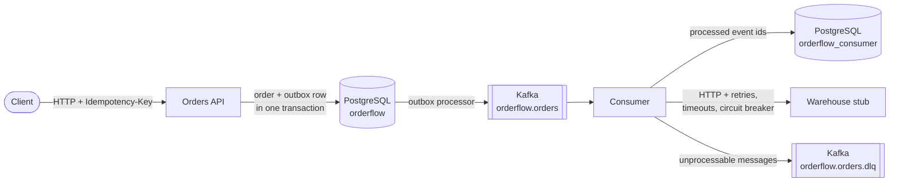

# OrderFlow

[](https://github.com/yeldos13/OrderFlow/actions/workflows/ci.yml)

An order service that publishes order events to Kafka and delivers them to an external warehouse system — without losing or duplicating events when Kafka or the warehouse fails.

Built with .NET 10, ASP.NET Core, EF Core, PostgreSQL, Kafka and Polly.

## Architecture



1. The API stores the order and its domain events in the same database transaction (transactional outbox).
2. A background processor publishes outbox rows to Kafka, keyed by order id, so events of one order stay in order.
3. The consumer reads Kafka, skips events it has already processed and forwards new ones to the warehouse.
4. Messages that can never be processed go to a dead letter topic; temporary failures are retried.

## What happens when things fail

| Failure | Behaviour |
|---|---|
| Client retries `POST /api/orders` | Same `Idempotency-Key` returns the stored response, no second order. A different body with the same key gets `422`. |
| Two requests change one order at once | Optimistic concurrency (`xmin`), the loser gets `409`. |
| Kafka is down | Orders are still accepted. Events wait in the outbox and are published in order once Kafka is back. |
| Broker rejects a message (e.g. too large) | The outbox row is marked as failed and skipped, the queue keeps moving. |
| Warehouse returns `5xx` or times out | Retries with exponential backoff and jitter, 2 s timeout per attempt. |
| Warehouse is down for a while | Circuit breaker opens, the consumer pauses until it half-opens. |
| Kafka redelivers a message | Deduplicated by event id, the warehouse receives it once. |
| Unknown event or warehouse `4xx` | Moved to `orderflow.orders.dlq` with the reason and original position in headers. |
| A service crashes mid-processing | Offsets are stored only after processing, so nothing is skipped (at-least-once). |

Health is exposed per service: `/health/live`, `/health/ready` (database only) and `/health` (JSON report with Kafka, outbox lag, consumer lag, circuit state). Kafka or warehouse problems report `Degraded`, not `Unhealthy`, so an orchestrator does not restart or unroute a service that is only waiting for a dependency.

## Quick start

Requires Docker.

```bash
cp .env.example .env
docker compose up -d --build
```

| URL | What |
|---|---|
| http://localhost:5100/scalar | API reference |
| http://localhost:5100/health | API health |
| http://localhost:5110/api/order-events | Events received by the warehouse stub and delivery counts |
| http://localhost:5120/health | Consumer health |
| http://localhost:8080 | Kafka UI |

Database migrations run as separate one-shot containers (EF Core migration bundles) before the services start.

Create and ship an order:

```bash
ORDER=$(curl -s -X POST http://localhost:5100/api/orders \
  -H "Content-Type: application/json" \
  -H "Idempotency-Key: $(uuidgen)" \
  -d '{"customerId":"6f1c2a8e-3b4d-4e5f-9a1b-2c3d4e5f6a7b","items":[{"productId":"a1b2c3d4-e5f6-4a7b-8c9d-0e1f2a3b4c5d","quantity":2,"unitPrice":10.50}]}' \
  | grep -o '"id":"[^"]*"' | cut -d'"' -f4)

curl -X POST http://localhost:5100/api/orders/$ORDER/confirm
curl -X POST http://localhost:5100/api/orders/$ORDER/ship
curl http://localhost:5110/api/order-events
```

## Failure scenarios to try

**Kafka outage.** Stop Kafka, create a few orders, then start it again. Orders are accepted, `/health` shows the outbox lag growing, and all events reach the warehouse after Kafka is back.

```bash
docker compose stop kafka
docker compose start kafka
```

**Unreliable warehouse.** The stub fails 20% of requests and answers 10% slowly by default. Change it at runtime:

```bash
curl -X PUT http://localhost:5110/api/chaos -H "Content-Type: application/json" \
  -d '{"outage":true,"failureRate":0,"slowRate":0,"slowDelayMs":0}'
```

With `outage: true` the consumer's `/health` shows the circuit as `Open`, then `Consumer is stalled` after a minute. Set it back to `false` and the backlog drains.

**Redelivery.** Replay the whole topic for the consumer group; the warehouse delivery counts stay at 1.

```bash
docker compose stop consumer
docker compose exec kafka /opt/kafka/bin/kafka-consumer-groups.sh --bootstrap-server kafka:29092 \
  --group orderflow-warehouse-sync --reset-offsets --to-earliest --topic orderflow.orders --execute
docker compose start consumer
```

**Dead letter topic.** Publish a message without event headers and look at `orderflow.orders.dlq` in Kafka UI.

```bash
echo "garbage" | docker compose exec -T kafka /opt/kafka/bin/kafka-console-producer.sh \
  --bootstrap-server kafka:29092 --topic orderflow.orders
```

## Development

Run only the infrastructure in Docker and the services from the IDE:

```bash
docker compose up -d postgres kafka kafka-init kafka-ui
dotnet user-secrets set "ConnectionStrings:OrderFlow" "Host=localhost;Port=5433;Database=orderflow;Username=orderflow;Password=<password>" --project src/OrderFlow.Api
dotnet user-secrets set "ConnectionStrings:ConsumerDb" "Host=localhost;Port=5433;Database=orderflow_consumer;Username=orderflow;Password=<password>" --project src/OrderFlow.Consumer
```

In Development both services apply their migrations on startup. Local ports: API `5138`, warehouse stub `5210`, consumer `5220`.

## Tests

```bash
dotnet test
```

- Unit tests (xUnit v3, Moq): domain rules and status transitions, validators, outbox mapping, consumer handler, warehouse error classification, consumer health with a fake clock.
- Integration tests (Testcontainers): the real API and consumer against PostgreSQL and Kafka containers — idempotency under concurrent requests, concurrency conflicts, event ordering, deduplication, dead lettering and retries.

Docker must be running for the integration tests. CI runs everything on every push and pull request.

## Project structure

```
src/
  OrderFlow.Domain          Order aggregate, status rules, domain events
  OrderFlow.Application     Use cases, DTOs, validation
  OrderFlow.Infrastructure  EF Core, outbox, Kafka publisher, idempotency store
  OrderFlow.Api             Controllers, error handling, idempotency filter, health
  OrderFlow.Contracts       Integration event contracts shared with consumers
  OrderFlow.Consumer        Kafka consumer, deduplication, Polly pipeline, DLQ
  OrderFlow.WarehouseStub   External system stand-in with configurable failures
tests/                      Unit and integration tests
```

## Design notes

- **Outbox instead of publishing after `SaveChanges`.** Writing to the database and to Kafka cannot be one transaction; the outbox makes the event part of the order's transaction and publishes it later. Rows are claimed with `FOR UPDATE SKIP LOCKED`, so several API instances can run the processor.
- **At-least-once, then deduplicate.** Exactly-once across Kafka and an HTTP system is not possible, so the consumer stores processed event ids. The event id is also sent to the warehouse so it can deduplicate the remaining window (crash after delivery, before recording).
- **Temporary vs permanent errors.** Retrying a malformed message forever blocks the partition; dead lettering a warehouse outage loses data. Errors are classified and handled separately on both the publishing and consuming side.
- **Ordering.** Events are keyed by order id. On a temporary failure the outbox and the consumer stop and retry the same message rather than skipping ahead.
- **Separate migration step.** Services do not need schema permissions and do not race each other on startup.

## Tech stack

.NET 10 · ASP.NET Core · EF Core 10 · PostgreSQL 18 · Kafka 4 (KRaft) · Confluent.Kafka · Polly 8 / Microsoft.Extensions.Http.Resilience · FluentValidation · Serilog · Scalar · xUnit v3 · Moq · Testcontainers · Docker Compose · GitHub Actions
